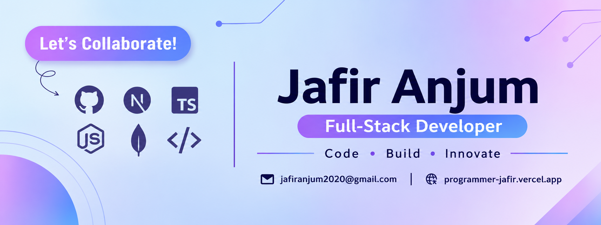

<!--- banner --->

 

<!--- title --->

  <ul align="center">
    
<h1 style="display: inline-block">Hi 👋, I'm Jafir Anjum</h1>

    <!--- typo --->
    

  </ul>

 

<!--- about --->
## 👨‍💻 About Me

- 👋 Hi, I'm **[Jafir Anjum](https://github.com/programmer-jafir)**, a passionate **Full-Stack Web Developer**.
- 🖥️ I work with **React.js, Next.js, TypeScript, Redux Toolkit, and Tailwind CSS** for frontend development.
- 🗄️ I build backend applications using **Node.js, Express.js, MongoDB, Mongoose, and REST APIs**.
- 🛠️ Currently exploring **PostgreSQL, Prisma, AI Integration, Docker, and AWS**.
- 💬 Ask me about **Full-Stack Development (React, Next.js, Node.js, Express.js, MongoDB)**.
- 🚀 Interested in building scalable web applications, digital products, and AI-powered solutions.
- 🌐 Explore my **[Portfolio](https://programmer-jafir.vercel.app)** and **[GitHub Projects](https://github.com/programmer-jafir)**.
- 📝 I enjoy sharing technical knowledge and learning through building real-world projects.
- 📫 Feel free to reach out: **[Email](mailto:jafiranjum2020@gmail.com)**
  
 

<!--- socials --->
## <b> FOLLOW ME ON SOCIALS:</b>

  

    
  

 

<!--- technology --->
##  <b> TECHNOLOGY STACK:</b>

### Languages:

### CSS Frameworks & Libraries:

### JavaScript Frameworks & Libraries:

### Database & Model:

### Deployment Platform:

### Design & Graphics:

### Tools & Technologies:

 

<!--- statistics --->
## <b> GITHUB STATISTICS & ANALYSIS:</b>

<h3 align="center">📊 GitHub Statistics & Languages</h3>

<table align="center">
  <tr>
    <td align="center">
      
    </td>
    <td align="center">
      
    </td>
  </tr>
</table>

<h3 align="center">🔥 GitHub Contribution Streak</h3>

  

 

<!--- random quote --->
##  <b> RANDOM DEV QUOTE:</b>

 

<!--- visit count --->

  

